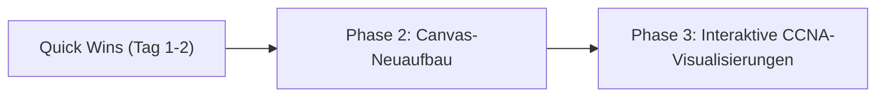

# CCNA-Lernplattform: Umfassender Audit-Bericht & Canvas-Inventur

> **Dokument:** Phase 1 Audit-Bericht (Cisco CCNA 200-301 Lernplattform)  
> **Repository:** `it-training-canvas-new` (Live: `ccna.ajti.online`)  
> **Zielgruppe:** Fachinformatiker Systemintegration (Umschulung / Weiterbildung), Desktop (1440px) & Smartphone (390px)  
> **Branch:** `feature/canvas-audit-redesign`  
> **Status:** Phase 1 abgeschlossen — Wartet auf Freigabe für Phase 2

---

## 1. Executive Summary & Die 10 wichtigsten Befunde

Die Bestandsaufnahme der Plattform `ccna.ajti.online` zeigt eine fachlich reichhaltige Grundlage mit über 1.200 Prüfungsfragen, 81 kuratierten Drag-and-Drop-Fragen mit Exhibit-Darstellung, 26 CCNA-Themenmodulen sowie spezialisierten Simulatoren. Gleichzeitig leidet die Plattform unter erheblichen architektonischen, visuellen und mobilen Schwachstellen im Canvas-Bereich, die das Lernerlebnis auf Smartphones und hochauflösenden Displays stark beeinträchtigen.

```
┌─────────────────────────────────────────────────────────────────────────────┐
│                       ARCHITEKTUR-ÜBERSICHT IST-ZUSTAND                     │
├─────────────────────────────────────────────────────────────────────────────┤
│ • React 19 + TypeScript 5.7 + Tailwind CSS v4 + Vite 7                      │
│ • State: App.tsx Monolith (~2.770 Zeilen, ~40 useState, useLocalStorage)     │
│ • Canvas: HTML5 2D Bitmap (<canvas>) mit gerasterten SVG-Blob-Bildern       │
│ • Routing: Kein URL-Router; 3D-CSS-Flip (rotateY 180deg) Front ↔ Back       │
│ • Content: 26 Module (Markdown/Text), 1.055 Fragen (JSON), 81 D&D (JSON)    │
└─────────────────────────────────────────────────────────────────────────────┘
```

### Die 10 wichtigsten Befunde im Detail:

1. **HiDPI/Retina-Unschärfe des Canvas (Kritisch):**  
   Der aktuelle HTML5 Canvas setzt `canvas.width = container.clientWidth` und ignoriert `window.devicePixelRatio`. Auf modernen Geräten (DPR 2x bis 3x) wirkt die Zeichenfläche verschwommen. Beim Hineinzoomen pixelieren Shapes sofort, da SVGs vorab als 80x80px Bitmaps gerastert werden.
   *(Referenz-Screenshot: `docs/screenshots/03_desktop_dark_canvas.png`)*

2. **Mobile Nichtbenutzbarkeit des Flip-Mechanismus auf 390px (Kritisch):**  
   Auf Smartphones (390px Breite) ist die obere Header-Navigationsleiste überfüllt und nicht responsiv umgebrochen. Der Flip-Button (`Canvas` / `Lernen`) wird rechts aus dem Viewport geschoben. Lernende am Smartphone können den Canvas weder gezielt betreten noch zur Lektion zurückkehren.
   *(Referenz-Screenshot: `docs/screenshots/09_mobile_dark_dashboard.png`)*

3. **Kollidierende und unpassende Overlays auf Mobilgeräten (Kritisch):**  
   Auf dem Canvas überlappen sich auf 390px die linke Tastaturkürzel-Box ("Linke Maustaste... Scrollrad... Ctrl+C...") und die "Simple/Detail"-Schalter vollständig. Eine Maus-Kürzel-Box auf einem Touchscreen stiftet Verwirrung.
   *(Referenz-Screenshot: `docs/screenshots/11_mobile_dark_canvas.png`)*

4. **Fehlender `ResizeObserver` führt zu Canvas-Verzerrungen:**  
   Die Canvas-Größe lauscht nur auf `window.addEventListener("resize")`. Wird die Fach-Sidebar eingeklappt, ein Dialog geöffnet oder die 3D-Flip-Animation ausgeführt, ändert sich der Container ohne Window-Resize. Die Folge: Asymmetrische Streckung und ungenaue Klick-/Touch-Koordinaten.

5. **Inkonsistentes Theming & unvollständiger Light-Mode:**  
   Es gibt keinen globalen Theme-Schalter auf der Lernoberfläche; der Toggle existiert nur in der Canvas-Toolbar. Zudem sind viele Dialoge und Oberflächen mit harten Klassen wie `bg-slate-900` und `bg-[#0a0f1e]` codiert, sodass ein Umschalten auf "Light" zu unlesbaren Farbkontrasten führt.
   *(Referenz-Screenshot: `docs/screenshots/02_desktop_light_dashboard.png`)*

6. **Fragmentierte Simulatoren statt integrierter Lernumgebung:**  
   Hochwertige CCNA-Simulatoren (VLAN-Simulator, STP-Simulator, OSI-Simulator, Routing-Drill) existieren als isolierte Dialog-Popups im "Tools"-Menü, sind jedoch weder mit den eigentlichen Lektionen noch mit dem Haupt-Canvas verknüpft. Der Canvas selbst startet leer und hat keinen Bezug zur aktuellen Lektion.

7. **SVG-Cache-Kollision und asynchroner Render-Drop im Canvas-Core:**  
   In `src/lib/canvas-utils.ts` wird der Cache-Key für Shapes mit `svgPath.substring(0, 50)` gebildet. Da Cisco- und IT-SVGs oft mit identischen Tags beginnen (`<svg xmlns="http://www.w3.org/2000/svg"...`), teilen sich verschiedene Shapes denselben Cache-Eintrag. Zudem führt asynchrones Laden bei Neuaufrufen zu fehlenden Icons ("..."-Platzhaltern).

8. **Fehlende Trennung von Prompt, Command und Output bei CLI-Exhibits:**  
   Cisco-IOS-Ausgaben (`show ip route`, `show mac address-table`, `running-config`) werden in einfachen unstrukturierten `<pre>`-Blöcken ohne Syntax-Highlighting dargestellt. Ein Prompt wie `Router#` ist optisch nicht vom Befehl oder der Ausgabe getrennt, was das Einprägen von Prüfungsbefehlen erschwert.
   *(Referenz-Screenshot: `docs/screenshots/18_desktop_cli_topic_detail.png`)*

9. **Eingeschränkte Touch-Bedienung bei den 81 Drag-and-Drop-Fragen:**  
   Obwohl eine Klick-Zuordnung implementiert ist, sind die Zielbereiche auf 390px Touchscreens zu schmal und erfordern extremes vertikales Scrollen. CLI-Exhibits in D&D-Fragen erzwingen horizontales Scrollen, was Touch-Gesten abfängt.
   *(Referenz-Screenshot: `docs/screenshots/17_mobile_drag_drop_exhibit.png`)*

10. **Barrierefreiheit (WCAG AA) & Semantik-Defizite:**  
    Der HTML5-Pixel-Canvas ist für Screenreader und Tastaturbedienung eine Black Box. Gesetzte Netzwerkgeräte besitzen keine barrierefreien Beschriftungen oder Fokus-Ringe. Farbkontraste im Dark-Mode (`text-slate-500` auf `bg-slate-950`) unterschreiten teilweise das Mindestkontrastverhältnis von 4,5:1.

---

## 2. Canvas-Inventur

Die nachfolgende Tabelle erfasst jede im aktuellen Code vorhandene Canvas-Funktion mit ihrem technischen Zustand, der Fehlerursache und der konkreten Handlungsempfehlung für den Neuaufbau.

| Funktion / Bereich | Status | Technische Ursache | Empfehlung für Phase 2 |
|---|---|---|---|
| **Canvas-Auflösung & DPI** | ❌ Defekt | `canvas.width = container.clientWidth` ignoriert `devicePixelRatio`; SVGs werden vorab auf feste 80x80px gerastert. | Wechsel auf **reines SVG-Rendering**. SVG ist per Definition auflösungsunabhängig, gestochen scharf auf HiDPI/Retina und skaliert verlustfrei. |
| **Resize-Handling** | ❌ Defekt | Nur `window.onresize`, kein `ResizeObserver` auf dem Parent-Container. Falsche Abmessungen nach Flip & Sidebar-Toggle. | `useResizeObserver` auf dem Canvas-Container; automatische SVG-ViewBox-Berechnung. |
| **Flip-Button & Transition** | ⚠️ Teilweise defekt | CSS 3D `rotateY(180deg)`. Auf 390px Mobile-Viewport ist der Button rechts im Header abgeschnitten. Kein URL-State. | Header-Layout mobil responsiv machen (Flip-Button immer fixiert oder als Floating Action Button); State optional in URL spiegeln (`?view=canvas`). |
| **Pan & Zoom (Desktop)** | ⚠️ Teilweise defekt | Manuelle Matrix-Transformation (`ctx.translate`, `ctx.scale`). Zoom skaliert Bitmap unscharf; kein Min/Max-Clamping. | SVG-ViewBox-Transformation mit Wheel-Event und glattem Zoom-Clamping (0.2x bis 3.0x). |
| **Pan & Zoom (Touch / Mobile)** | ❌ Defekt | Touch-Handler (`activePointers`, `pinchRef`) kollidieren mit Browser-Gesten; keine Touch-Action-Sperre. | `touch-action: none` auf SVG-Root; PointerEvents-basierter Multitouch Pinch-to-Zoom. |
| **Ansicht einpassen (Fit View)** | ⚠️ Teilweise defekt | Berechnet Bounding-Boxes ungenau; Rand-Shapes und Verbindungs-Labels ragen aus dem sichtbaren Bereich. | Exakte Bounding-Box aller SVG-Nodes ermitteln und mit Padding in die ViewBox einpassen. |
| **Freihand-Stift (Pen)** | ⚠️ Teilweise defekt | Array von Koordinatenpunkten auf Bitmap. Nicht editierbar, unvollständige Selektion. | Als SVG `<path d="M... Q...">` mit Catmull-Rom-Spline oder vereinfachen/entfernen zugunsten von CCNA-relevanten Tools. |
| **Radierer (Eraser)** | ❌ Defekt | Zeichnet mit `ctx.fillStyle = bgColor` über Pixel. Funktioniert nicht bei Farbwechsel und hinterlässt Bitmap-Spuren. | Vektorielles Löschen: Entfernt das anvisierte Objekt sauber aus dem Zustand. |
| **Formen (Rechteck / Kreis / Linie / Pfeil)** | ⚠️ Teilweise defekt | Nur einfache `strokeRect` / `arc` / `lineTo`. Kein Einrasten an Geräte-Ports. | Als SVG-Zonen (Subnetz-Zonen, DMZ, VLAN-Bereiche) mit semantischem Labeling neu definieren. |
| **Text-Werkzeug** | ⚠️ Teilweise defekt | Textarea-Overlay mit Positionsversatz bei Zoom; nach Platzierung nicht mehr direkt im Text bearbeitbar. | Inline-SVG-Text mit ForeignObject-Editor oder Modal-Edit per Doppelklick. |
| **Shape-Bibliothek (IT_SHAPES)** | ⚠️ Teilweise defekt | 50+ Shapes vorhanden, aber Cache-Key-Kollision (`substring(0, 50)`). Heterogene Icons (Azure, AWS, K8s gemischt mit CCNA). | **Fokussierte CCNA-SVG-Icon-Familie** (Router, L2-Switch, L3-Switch, Firewall, AP, WLC, PC, Server, Cloud) im einheitlichen Cisco-Diagramm-Stil. |
| **Geräte-Ports & Snapping** | ⚠️ Teilweise defekt | 4 Ports (top, right, bottom, left) hartcodiert. Snapping bricht bei skalierten Shapes ab. | Dynamische Port-Definitionen je nach Gerätetyp (z. B. Gi0/0, Gi0/1, Fa0/1–24) mit optischem Fangradius. |
| **Verbindungen (Links)** | ⚠️ Teilweise defekt | Bezier-Kurven und gerade Linien auf Canvas. Text-Labels überlappen und verdecken Linien. | SVG-Links mit semantischer CCNA-Typisierung (Ethernet, Serial, Trunk 802.1Q, EtherChannel, WLAN, Status Up/Down/STP-Blocking). |
| **Geräte-Konfiguration (Properties)** | ⚠️ Teilweise defekt | `ShapeConfigDialog` vorhanden, aber isoliert vom echten L2/L3-Netzwerkverhalten. | Beim Anklicken: Kompaktes **Detail-Panel** (Sidebar/Flyout) mit Interface-Tabelle, IP/Maske, VLAN-Zugehörigkeit und CLI-Preview. |
| **MiniMap** | ❌ Defekt | Separater zweiter Canvas, oft asynchron zur Hauptanzeige; Viewport-Rechteck auf Mobile unbrauchbar. | Leichtgewichtige SVG-MiniMap oder auf Mobile standardmäßig ausblenden. |
| **Density Toggle (Simple / Detail)** | ⚠️ Teilweise defekt | Blendet Verbindungstexte aus. Auf Mobile unbedienbar wegen Überlappung mit Shortcuts-Box. | UI-Positionierung bereinigen; Simple = nur Verbindungstyp/Farbe, Detail = Interface-Namen (Fa0/1) & IP-Subnetze. |
| **Simulation / Packet Flow** | ❌ Defekt | Nur Mock-Pfadsuche (`network-simulator.ts`); ignoriert STP-Blocking, Routingtabellen, Subnetze und ARP. | Paketfluss-Visualisierer mit echter CCNA-Hop-Logik (MAC-Wechsel, gleichbleibende IP, TTL-Dekrement). |
| **Export / Import** | ⚠️ Teilweise defekt | PNG-Export verpixelt bei Zoom; SVG-Export fehlerhaft durch eingebettete `data:image` Blobs. JSON stabil. | Sauberer nativer SVG-Export (1:1 Vektor) sowie High-Res PNG via SVG-to-Canvas Supersampling. JSON-Schema dokumentieren. |

---

## 3. CCNA-Themen-Audit (6 Prüfungsbereiche)

Bewertung aller 6 Domänen des aktuellen Cisco CCNA 200-301 Curriculums hinsichtlich aktuellem Darstellungszustand, didaktischem Visualisierungspotenzial, Aufwand (S/M/L) und Lernnutzen.

| Prüfungsbereich & Topic | Ist-Zustand | Didaktischer Visualisierungsvorschlag | Aufwand | Lernnutzen |
|---|---|---|---|---|
| **1. Network Fundamentals**<br>• OSI- & TCP/IP-Modell<br>• Komponenten (Router, Switch, FW, AP, WLC)<br>• Topologien (2-Tier, 3-Tier, Spine-Leaf)<br>• Verkabelung & Interfaces | Überwiegend Markdown-Text (`networking-fundamentals.ts`). Separater OSI-Simulator im Tools-Menü. Tabelle für Kabeltypen. | **Interaktiver PDU Encapsulation Deconstructor**: Schrittweiser Aufbau eines Pakets von Schicht 7 bis Schicht 1 mit Live-Inspektion der Header (TCP-Port → IP-Adresse → MAC-Adresse + FCS). Spine-Leaf vs. 3-Tier Topologie-Umschalter auf dem Canvas. | **M** | **Hoch** |
| **2. Network Access**<br>• VLANs & 802.1Q Trunking<br>• STP / RSTP (802.1D / 802.1w)<br>• EtherChannel (LACP/PAgP)<br>• WLAN-Architektur (WLC/CAPWAP) | Detaillierte Textkonzepte (`switching-vlans.ts`, `vlan-advanced.ts`). Solide Standalone-Simulatoren für VLAN & STP im Dialog. | **STP-Konvergenz-Animation live im Canvas**: Farbliche Port-Zustände (Forwarding [grün], Blocking [orange]), Root-Bridge-Wahl (Priority + MAC), BPDU-Austausch mit Step-by-Step Steuerung. 802.1Q-Trunk-Frame-Durchleuchter mit 4-Byte Tag. | **L** | **Sehr hoch** |
| **3. IP Connectivity**<br>• IPv4 Subnetting & VLSM<br>• IPv6 Adressierung & EUI-64<br>• Routingtabelle & Longest Prefix Match<br>• OSPFv2 Single- & Multi-Area | Text mit Markdown-Tabellen. Isolierter Subnetting-Drill & Routing-Simulator. IPv6-Rechner im Tool-Menü. | **Interaktiver Longest Prefix Match Explorer**: Ziel-IP eingeben → Routingtabelle scannt Einträge zeilenweise ab, zeigt Bitmasken-Abgleich, Admin Distance und Metrik. Visueller Subnetting-Baum mit Binär-Gegenüberstellung (Netz/Host-Trennung). OSPF DR/BDR-Wahl-Animation. | **L** | **Sehr hoch** |
| **4. IP Services**<br>• DHCP (DORA) & Relay Agent<br>• NAT / PAT (Dynamic, Static, Overload)<br>• NTP, DNS, SNMP, Syslog<br>• FHRP (HSRP Failover) | Textbeschreibungen (`dhcp-nat.ts`, `fhrp.ts`). Keine interaktive Darstellung des Paket-Handshakes. | **NAT/PAT Translation Table Live-Visualizer**: Paket wandert von Host durch Router ins Internet; Inside Local wird zu Inside Global mit dynamischem Port übersetzt. Animierter DHCP-DORA-Ablauf mit Broadcast vs. Unicast Erkennung. | **M** | **Hoch** |
| **5. Security Fundamentals**<br>• Standard & Extended ACLs<br>• Port Security & Violation Modes<br>• DHCP Snooping & DAI<br>• AAA, VPN & WPA3 | Ausführlicher Text (`security.ts`). ACL-Drill-Quiz für Wildcard-Masken. | **Interaktiver ACL Rule Engine Evaluator**: Paket definieren (Src, Dst, Port) → ACL wird Regel für Regel durchlaufen ("First Match Wins") bis Permit oder Implicit Deny. Port-Security Simulator (Shutdown vs. Restrict bei unbekannter MAC). | **M** | **Sehr hoch** |
| **6. Automation & Programmability**<br>• Controller-Architektur (Cisco Catalyst)<br>• REST APIs & HTTP Status Codes<br>• Datenformate (JSON, YAML, XML)<br>• Konfigurationsmanagement (Ansible) | Reiner Text (`automation.ts`, `sdn-controller.ts`) mit Codeblöcken. | **REST API & JSON Payload Explorer**: Simulierte GET/POST Anfragen an Cisco Catalyst Center API mit interaktivem JSON-Baum, Syntax-Highlighter und Status-Code-Erklärung (200, 201, 401, 404). Vergleich von JSON/YAML mit Validierungsprüfung. | **S** | **Mittel** |

---

## 4. Layout- und Design-Audit

### 4.1 Visuelle Konsistenz & Design-Tokens
- **Farbraum & Tokens:** Das System nutzt Tailwind CSS v4 und OKLch CSS-Variablen in `src/index.css`. Allerdings sind an Dutzenden Stellen harte Hex-Codes (`#0a0f1e`, `#10B981`) und statische Tailwind-Slate-Klassen (`bg-slate-900`, `text-slate-200`) hart in die Komponenten geschrieben.
- **Light-Mode-Problem:** Beim Umschalten auf Light-Mode bleiben die Canvas-Hintergründe und viele Dialoge düster oder weisen unlesbare Kontraste auf (dunkler Text auf dunklem Grund).
- **Typografie:** IBM Plex Sans und IBM Plex Mono sind hervorragend für IT-Plattformen geeignet, werden aber nicht überall diszipliniert eingesetzt. Prompts und CLI-Befehle nutzen teilweise serifenlose UI-Schriften.

### 4.2 Navigation, Informationshierarchie & Lernfluss
- **Verwirrende Fach-Sidebar:** Die Sidebar links suggeriert eine Multi-Themen-Plattform (FISI, Azure, AWS, Linux, K8s). Da es sich hier um eine spezialisierte CCNA-Plattform (`ccna.ajti.online`) handelt, lenken diese Tabs vom CCNA-Fokus ab und nehmen kostbaren Platz weg.
- **Top-Bar Overload:** 11 Buttons im Header (Lernpfade, Gerät, CLI, Labs, Tools, Prüfung, Priorisiert, Ping, Mehr, Anmelden, Canvas) überfordern den Nutzer und zerstören das Layout unterhalb von 1280px Breite.
- **Lernfluss:** Nach Abschluss eines Themas fehlt ein klarer primärer Call-to-Action ("Nächste Lektion starten" oder "Passendes Lab auf dem Canvas öffnen").

### 4.3 Darstellung von CLI-Ausgaben
- **Ist-Zustand:** Einfache `<pre>`-Tags ohne Syntax-Hervorhebung.
- **Soll-Zustand:** Eine dedizierte Komponente `CiscoCliView` mit:
  - Klarer visueller Trennung von Prompt (`Router(config-if)#`), Befehl (`ip address 192.168.1.1 255.255.255.0`) und Systemausgabe.
  - Farbiger Hervorhebung von Interface-Namen (`GigabitEthernet0/1`), IP-Adressen, VLAN-IDs und Statusanzeigen (`up/up`, `administratively down`).
  - Integriertem Copy-to-Clipboard-Button und optionalem "Try in Terminal"-Button.

### 4.4 Exhibits und die 81 Drag-and-Drop-Fragen
- **Funktionalität:** Der Klick-basierte Zuordnungs-Modus ("Item antippen → Ziel antippen") funktioniert robust und ist eine wichtige Alternative zum Desktop-Drag auf Touchgeräten.
- **Schwachstellen:**
  - Auf 390px Mobile-Breite sind die Boxen für Ziel-Items zu klein (erhöhtes Missklick-Risiko).
  - CLI-Exhibits (z. B. `show ip route` in Frage `dd-q0480`) erfordern horizontales Scrollen im Code-Block, was leicht zu versehentlichem Seiten-Wischen führt.
  - Die Ergebnis-Darstellung nach dem Prüfen könnte deutlicher anzeigen, welches Element wohin gehört hätte.

### 4.5 Barrierefreiheit (WCAG 2.1 AA)
- **Kontrast:** Mehrere Beschriftungen in `text-slate-500` erreichen auf `#0a0f1e` nur 3,1:1 (WCAG AA fordert mindestens 4,5:1 für Text unter 18pt).
- **Tastaturbedienung:** Auf dem aktuellen Canvas kann kein Gerät per Tastatur selektiert, bewegt oder verbunden werden.
- **Screenreader:** Das HTML5-Canvas-Element bietet keinerlei semantische Informationen über die dargestellte Netzwerktopologie.

---

## 5. Priorisierte Roadmap



### 1. Quick Wins (Sofortige Stabilität ohne Architekturumbruch)
1. **Mobile Header & Flip-Button fixieren:** Header-Buttons auf Mobile in ein Dropdown/Drawer verlegen; Flip-Button "Canvas/Lernen" als fester Schalter immer sichtbar halten.
2. **Overlay-Bereinigung auf 390px:** Die störende Tastatur-Shortcuts-Box auf Touchscreens ausblenden (`hidden md:block`); Kollision mit den View-Density-Buttons beseitigen.
3. **SVG-Cache-Key Bugfix:** In `canvas-utils.ts` den Cache-Key auf `shape.id` umstellen, um Icon-Kollisionen sofort zu eliminieren.
4. **Globale Theme-Umschaltung:** Theme-Toggle in den allgemeinen Header integrieren, damit Nutzer auch im Dashboard zwischen Dark und Light wechseln können.
5. **Mobile Sidebar einklappbar machen:** Fach-Sidebar auf Viewports < 768px standardmäßig ausblenden (Hamburger-Drawer).

### 2. Mittlere Vorhaben (Phase 2 Kern)
1. **Neuer SVG-basierter Canvas:**
   - Vollständige Ablösung des HTML5-Bitmap-Canvas durch ein modernes, leichtes SVG-Viewport-System.
   - Verluste freier Zoom & Pan mit Gestenunterstützung (Pointer Events).
   - Sauberes `ResizeObserver`-Handling.
2. **Datengetriebenes Topologie-Schema:**
   - Formales JSON-Schema für CCNA-Topologien (`devices`, `interfaces`, `links`, `vlans`, `subnets`).
   - 8 fertige CCNA-Referenz-Topologien (Router-on-a-Stick, STP-Dreieck, OSPF Multi-Area, FHRP/HSRP Redundanz etc.).
3. **Einheitliche CCNA-Icon-Bibliothek:**
   - Scharfe, einheitliche Vektor-Icons im Cisco-Standardstil (Router, L2-Switch, L3-Switch, Firewall, AP, WLC, PC, Server, Cloud).
4. **Geräte-Detailpanel:**
   - Beim Klick auf ein Gerät öffnet sich ein Slide-Over Panel mit Interface-Status, IP-Konfiguration und simulierten `show`-Befehlen.

### 3. Große Vorhaben (Phase 3 Interaktionen & Animationen)
1. **Paketfluss-Visualisierung mit Hop-by-Hop Encapsulation:**
   - Paket wandert von PC1 zu PC2 über Switches und Router.
   - An jedem Hop wird gezeigt: Quell/Ziel-MAC wechselt, Quell/Ziel-IP bleibt gleich, TTL wird dekrementiert.
2. **STP-Konvergenz Schritt für Schritt:**
   - Interaktive Wahl der Root-Bridge, Bestimmung von Root-Ports, Designated Ports und Blocking Ports mit Live-Statusanzeige.
3. **Interaktiver Longest Prefix Match Routing-Table Lookup:**
   - Didaktischer Rechner, der visuell zeigt, warum `/26` vor `/24` gewinnt.
4. **Interaktiver ACL-Evaluator & NAT-Session-Tracker.**

---

## 6. Technologie-Empfehlung für den neuen Canvas

### Warum SVG die überlegene Lösung gegenüber Pixel-Canvas ist:

```
┌─────────────────────────┬─────────────────────────┬─────────────────────────┐
│ Kriterium               │ HTML5 Canvas (Ist)      │ SVG-basiert (Empfehlung)│
├─────────────────────────┼─────────────────────────┼─────────────────────────┤
│ Schärfe & HiDPI         │ ❌ Pixelig bei Zoom     │ ✅ Mathematisch scharf  │
│ Responsive & Resize     │ ❌ Manuelles Repaint    │ ✅ Deklarative viewBox  │
│ Styling & Theming       │ ❌ JS-Farben hartcodiert│ ✅ Tailwind / CSS Tokens│
│ Event-Handling / Touch  │ ❌ Komplexe Mathematik  │ ✅ Native DOM-Events    │
│ Barrierefreiheit (A11y) │ ❌ Black Box            │ ✅ Semantische DOM-Nodes│
│ Animationen             │ ❌ 60fps JS-Schleife    │ ✅ GPU-beschl. CSS/SVG  │
│ Bundle-Größe            │ —                       │ ✅ 0 KB externe Libs    │
└─────────────────────────┴─────────────────────────┴─────────────────────────┘
```

### Empfohlener Architektur-Stack:
1. **Kern-Rendering: Reines React 19 + SVG (`<svg className="w-full h-full">`)**
   - **Keine schwerfälligen Canvas-Frameworks:** Bibliotheken wie Konva oder Fabric.js sind auf Bitmap-Canvas optimiert und bringen unnötigen Overhead und React-19-Kompatibilitätsprobleme mit.
   - **Zoom & Pan:** Eine leichtgewichtige, performante Transformation über das SVG `viewBox`-Attribut (`minX, minY, width, height`). Änderungen an Zoom und Pan manipulieren lediglich 4 Zahlen in der ViewBox, anstatt jeden Knoten per JavaScript neu zu zeichnen.
2. **Datenmodell: Typisiertes Topologie-JSON**
   ```typescript
   export interface TopologyDevice {
     id: string;
     name: string;
     type: "router" | "switch-l2" | "switch-l3" | "firewall" | "ap" | "wlc" | "server" | "pc" | "cloud";
     x: number;
     y: number;
     interfaces: Array<{
       id: string;
       name: string; // z.B. Gi0/0/0
       ip?: string;  // z.B. 192.168.1.1/24
       mac?: string;
       vlan?: number;
       status: "up" | "down" | "admin-down";
     }>;
     config?: {
       hostname: string;
       routingProtocols?: string[];
       vlans?: Array<{ id: number; name: string }>;
       showOutputs?: Record<string, string>; // simulierte Befehlsausgaben
     };
   }

   export interface TopologyLink {
     id: string;
     sourceDeviceId: string;
     sourceInterface: string;
     targetDeviceId: string;
     targetInterface: string;
     linkType: "ethernet" | "serial" | "trunk" | "etherchannel" | "wireless";
     status: "up" | "down" | "stp-blocking" | "stp-forwarding";
     vlansAllowed?: number[];
   }
   ```
3. **Animationen:**
   - Verwendung von CSS `@keyframes` mit `stroke-dashoffset` für fließende Paket-Datenströme.
   - Volle Unterstützung von `@media (prefers-reduced-motion: reduce)`: Wenn aktiv, werden Animationen automatisch als statische Schrittanzeige dargestellt.

---

## 7. Fazit & Nächste Schritte

Phase 1 hat alle Stärken und gravierenden Schwachstellen der Plattform transparent offengelegt. Der bestehende Code wurde während des Audits **nicht verändert**.

**Nächster Schritt:**  
Nach deiner Durchsicht und deinem **OK** beginnen wir mit **Phase 2: Canvas-Neuaufbau** auf dem Feature-Branch `feature/canvas-audit-redesign`.
