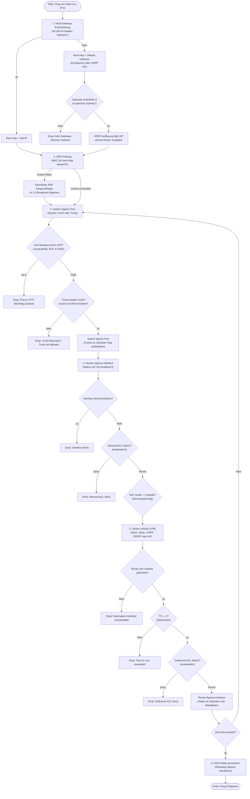

# Konzept: Fachlich korrekte Netzwerksimulation in Canvas v2

> **Dokumentstatus:** Phase 0 — Analyse & Architekturkonzept
> **Branch:** `feature/v2-simulation`
> **Referenzen:** `docs/lab-topologien/UEBERGABE.md`, `docs/lab-topologien/BERICHT-SHOW-OUTPUTS.md`, `src/lib/topology/`

---

## 1. Inventur der v1-Funktionen (Ist-Zustand Canvas v1)

Canvas v1 enthält mehrere Simulations- und Diagnose-Werkzeuge, die historisch gewachsen sind und weitgehend auf einer heuristischen, von der tatsächlichen Cisco-Logik losgelösten Codebasis beruhen.

### 1.1 Übersicht der v1-Komponenten und Dateien

| Komponente | Datei | Zeilen | Aufgabe in v1 |
|---|---|---|---|
| **Geführter Ping-Test** | `src/components/PingScenarioDialog.tsx` | 1–433 | Modal-Dialog zur Auswahl von Quell- und Ziel-Shape (`DrawingObject[]`), schrittweise Animation des Pings mit 1200 ms Auto-Play. |
| **Topologie-Simulation (HUD)** | `src/components/SimulationControls.tsx` | 1–525 | Schwebende Steuerleiste (`fixed bottom-28 left-1/2`), Play/Pause/Stop, Geschwindigkeitsregler (0.5x–4x), Protokollauswahl (PING, TCP, UDP, etc.), manuelles Absenden von Paketen und 5-Zeilen-Logfenster. Enthält den Hook `useSimulation`. |
| **Live-Metriken** | `src/components/MetricsDashboard.tsx` | 1–561 | Modal-Dashboard mit Mini-Charts (HTML5 Canvas 2D) für CPU, RAM, Netzwerk-In/Out, Disk Read/Write, Latenz, Requests/s, Fehlerrate pro Shape. |
| **Packet-Flow Visualizer** | `src/components/PacketFlowVisualizer.tsx` | 1–536 | Schwebendes Fenster mit Detailinspektion von Hops, PDU-Schichten (L2–L7) und Schiebereglern für Latenz, Jitter und Packet-Loss. |
| **Simulation-Engine v1** | `src/lib/network-simulator.ts` | 1–451 | Erzeugt Trace-Schritte (`simulatePacketTrace`), BFS-Pfadsuche (`findPath`), Metrikengenerator (`generateShapeMetrics`) und Cloud-Preisrechner (`CLOUD_PRICING`). |
| **Networking-Engine v1** | `src/lib/networking-engine.ts` | 1–1678 | 1678 Zeilen umfassende Parallel-Implementierung von IP-Math, Konnektivitätsprüfung (`checkConnectivity`), Routing, ARP, DHCP, DNS, ACL, NAT und STP auf Basis von v1 `DrawingObject` und `CanvasConnection`. |
| **Canvas-Paketdarstellung** | `src/components/Canvas.tsx` | 580–621 | Rendert animierte Pakete als Kreise direkt auf das 2D-Canvas. |

---

### 1.2 Detailanalyse der v1-Funktionsweisen und Defizite

#### A. Geführter Ping-Test (`PingScenarioDialog.tsx`)
* **Funktionsweise:** Filtert alle v1-Objekte mit IP oder Label (`endpoints`), lässt Quelle und Ziel per `<Select>` wählen und ruft `simulatePacketTrace(sourceId, targetId, "PING", objects, connections)` auf. Schrittweiser Durchlauf mit Auto-Advance (1200 ms).
* **Defizite:**
  * Basiert auf v1 `DrawingObject` und `CanvasConnection`.
  * Verwendet `networkConfig` mit zufallsbasiertem Jitter und Packet-Loss.
  * Unterscheidet nicht zwischen Hin- und Rückweg eines Pings.
  * Keine Anbindung an die in v2 existierenden Cisco-Topologie- und Routing-Modelle.

#### B. HUD & Simulations-Loop (`SimulationControls.tsx` & `useSimulation`)
* **Funktionsweise:** `useSimulation` verwaltet einen Animation-Loop via `requestAnimationFrame` (`SimulationControls.tsx:382–436`). In jedem Frame wird `packet.progress` anhand von Zeitdelta und Geschwindigkeitsfaktor inkrementiert:
  ```typescript
  // SimulationControls.tsx:390
  const newProgress = packet.progress + delta * prev.speed * 0.5;
  ```
* **Defizite:**
  * Der Fortschritt ist rein zeitgesteuert und linear (0.0 bis 1.0).
  * Paketankunft generiert künstliche Log-Einträge (`"PING Paket empfangen"`).
  * Nicht responsive oder für Barrierefreiheit optimiert (`prefers-reduced-motion` wird ignoriert).

#### C. Canvas-Rendering der Pakete (`Canvas.tsx:580–621`)
* **Funktionsweise:** Berechnet die Position eines Pakets durch lineare Interpolation zwischen Quell- und Ziel-Bounding-Box:
  ```typescript
  // Canvas.tsx:592-595
  const packetX = sourcePos.x + (targetPos.x - sourcePos.x) * packet.progress;
  const packetY = sourcePos.y + (targetPos.y - sourcePos.y) * packet.progress;
  ```
* **Kritischer Fehler:** Das Paket schneidet querfeldein in einer geraden Linie durch das Diagramm, ignoriert tatsächliche Kabelverbindungen, Knickpunkte (`bendPoints`) und Zwischengeräte (Switches/Router).

#### D. Live-Metriken & Erfundene Daten (`MetricsDashboard.tsx` & `network-simulator.ts`)
* **Funktionsweise & Erfundene Werte:** `generateShapeMetrics` (`src/lib/network-simulator.ts:322–377`) erzeugt synthetische Zeitreihen mit `Math.random()`:
  ```typescript
  // network-simulator.ts:333-344
  const baseCpu = isRunning ? 20 + Math.random() * 30 : isError ? 85 + Math.random() * 15 : 0;
  const baseMem = isRunning ? 40 + Math.random() * 20 : isError ? 90 + Math.random() * 10 : 0;
  const baseNet = isRunning ? 50 + Math.random() * 200 : 0;
  ```
  Zudem enthält `network-simulator.ts:382–450` Cloud-Kostenmodelle (`CLOUD_PRICING` für AWS, Azure, GCP mit VM-Typen wie `t3.micro`, `B2s`, `n1-standard-1`) und Heuristiken (`detectCloudProvider`), die mit CCNA-Netzwerk- und Lab-Topologien fachlich nichts zu tun haben.
* **Erfundene MAC-Adressen und Latenzen:**
  * `generateMAC()` (`src/lib/networking-engine.ts:94–100`) generiert Zufalls-Hex-Bytes:
    `00:${hex()}:${hex()}:${hex()}:${hex()}:${hex()}`
  * Künstliche Latenz per Hop (`networking-engine.ts:389`): `totalLatency += 2 + Math.random() * 3;`
  * Künstlicher Jitter (`network-simulator.ts:176`): `(Math.random() - 0.5) * 2 * networkConfig.jitterMs`

#### E. Doppelte Netzwerk-Logik in `networking-engine.ts`
* In `src/lib/networking-engine.ts` existiert eine komplette eigene Implementierung von STP (`calculateSTP`, L1069), Routing (`findNextHopFromRouting`, L450), ACLs (`checkACL`, L637), NAT (`checkNAT`, L728) und ARP (`resolveARP`, L786).
* Diese Implementierung ignoriert alle fundierten Berechnungen aus `src/lib/topology/` (wie Dijkstra in `ospf-routes.ts`, L2-Segment-Walking in `ospf-neighbors.ts`, 802.1D Bridge-Wahlen in `stp-calc.ts`, etc.) und arbeitet ausschließlich auf den primitiven Feldern von v1 `DrawingObject.config`.

---

## 2. Inventur der vorhandenen v2-Module für die Simulation

Canvas v2 verfügt in `src/lib/topology/` über präzise, deterministische Module, die direkt aus der CCNA-Spezifikation und den realen Cisco IOS Show-Befehlen abgeleitet sind. Die neue Simulationsfunktion muss diese Module direkt nutzen, anstatt eigene Protokolllogik neu zu erfinden.

### 2.1 Vorhandene Module und ihre Wiederverwendung

| Protokoll / Funktion | Vorhandenes v2-Modul & Funktion | Wiederverwendung in der Simulation |
|---|---|---|
| **L2-Segmente, VLANs & Trunks** | `src/lib/topology/ospf-neighbors.ts`:<br>• `collectSegmentPeers(topology, device, local, first, link, vlanOverride)`<br>• `localEndpoints(topology, device)`<br>• `endpointsForInterface(topology, device, iface)`<br>• `portCarriesVlan(iface, vlan)`<br>• `untaggedVlan(iface)` | **Exakte L2-Weiterleitung:**<br>Verfolgt den Pfad eines Frames über L2-Switches, Access-Ports, 802.1Q-Trunks mit `allowedVlans`, `nativeVlan` und Router-on-a-Stick (dot1q Subinterfaces wie `Gi0/0.10`). |
| **STP-Zustände (Spanning Tree)** | `src/lib/topology/stp-calc.ts`:<br>• `computeStp(topology)`<br>• `isBlockedByStp(link, ...ifaces)` (in `ospf-neighbors.ts:148`) | **STP-Blocking:**<br>Ermittelt Root-Bridge, Port-Rollen (`Root`, `Desg`, `Altn`) und Port-Zustände (`FWD`, `BLK`). Pakete dürfen keine Ports im Zustand `BLK` passieren. Bei Linkausfall (`link.status = "down"`) berechnet `computeStp` sofort den neuen Zustand. |
| **Routing-Tabelle & LPM** | `src/lib/topology/cisco-cli-generator.ts:74–170`<br>`src/lib/topology/static-routes.ts`:<br>• `installedStaticRoutes(device)`<br>• `connectedInterfaceFor(device, ip)`<br>• `ipInCidr(ip, cidr)`<br>`src/lib/topology/ospf-routes.ts`:<br>• `computeOspfRoutes(device, topology)` (`ospfSpf` Dijkstra)<br>• `computeOspfExternalRoutes(device, topology)`<br>`src/lib/topology/eigrp-ipv4.ts`:<br>• `computeEigrpRoutes(device, topology)` | **L3 Next-Hop Lookup:**<br>Die aktive Routing-Tabelle eines Routers setzt sich aus direkt verbundenen Netzen (`C`/`L`), installierten statischen Routen (`S`/`S*`), OSPF (`O`/`O IA`/`O E1`/`O E2`) und EIGRP (`D`/`D EX`) zusammen, arbitriert durch die Administrative Distance (AD: C=0, S=1, D=90, O=110, D EX=170).<br>Für die Simulation wird daraus das **Longest Prefix Match (LPM)** abgeleitet. |
| **First-Hop Redundancy (HSRP)** | `src/lib/topology/hsrp.ts`:<br>• `computeHsrp(device, topology)` | **Default-Gateway-Auflösung:**<br>Ermittelt, welcher Router für eine virtuelle IP (VIP) aktuell im Zustand `Active` ist. Berücksichtigt Interface-Tracking (Prioritätsabzug, wenn getracktes Interface down ist) und Preemption. |
| **Network Address Translation (NAT)** | `src/lib/topology/nat-outputs.ts`<br>`src/types/topology.ts` (`DeviceNatConfig`) | **Paket-Übersetzung (L3/L4):**<br>Prüft beim Passieren von `insideInterfaces` zu `outsideInterfaces` die statischen Zuordnungen (`statics: local <-> global`) und dynamischen Pools/Overload (`rules`). Rückverkehr wird auf dem Outside-Interface symmetrisch zurückübersetzt. |
| **Tunnel (GRE & IPsec)** | `src/lib/topology/gre-tunnel.ts`:<br>• `computeTunnelState(device, iface, topology)`<br>`src/lib/topology/ipsec.ts`:<br>• `computeCryptoDiagnostics(device, topology)` | **Tunnel-Kapselung:**<br>Prüft, ob Tunnel-Source und Tunnel-Destination routingtechnisch erreichbar sind (`lineProtocol: "up"`). Wenn ja, wird das Paket rekursiv gekapselt und über den physischen Pfad geroutet. |
| **Interface- & Link-Status** | `TopologyInterface.status` ("up" \| "down" \| "admin-down")<br>`TopologyInterface.isShutdown`<br>`TopologyLink.status` ("up" \| "down" \| "stp-blocking") | **Pfadverfügbarkeit:**<br>Prüft, ob Schnittstellen administrativ (`shutdown`) oder physisch `down` sind. |

---

### 2.2 Was in v2 aktuell noch fehlt (Identifizierte Lücken)

1. **Strukturierte Schnittstelle für Routing-Table & LPM:**
   * `CiscoCliGenerator.generateShowIpRoute` erzeugt aktuell formatierte Textzeilen (`string`) für die CLI-Ansicht.
   * *Benötigt:* Ein reines Datenmodell-Extraktor `getRoutingTable(device: TopologyDevice, topology: NetworkTopology): RoutingTableEntry[]` und eine Funktion `lookupRouteLpm(entries: RoutingTableEntry[], targetIp: string): RouteMatch | null`, die strikt nach längster Präfixlänge (z. B. `/32` vor `/24` vor `/0`) und bei Gleichstand nach niedrigster AD entscheidet.
2. **Laufzeit-ACL-Auswertung an Schnittstellen:**
   * `src/lib/acl-drill.ts` besitzt bereits die Testfunktionen `wildcardMatches` und `evaluateAcl(aces, packet)` mit First-Match-Logik und implizitem Deny.
   * `src/components/labs/lab-to-network.ts` parst `accessLists?: Record<string, string[]>` in `DeviceConfig`.
   * *Lücke:* In `TopologyInterface` (`src/types/topology.ts`) fehlen bisher die Felder für an Schnittstellen gebundene Access-Groups:
     ```typescript
     inboundAcl?: string;   // ip access-group <name|num> in
     outboundAcl?: string;  // ip access-group <name|num> out
     ```
     und der entsprechende Parser in `lab-to-network.ts`.
3. **Deterministisches ARP-Modell:**
   * Keine erfundenen Zufalls-MACs! Wenn eine Schnittstelle `iface.mac` konfiguriert hat, wird diese genutzt. Andernfalls wird ein symbolischer Bezeichner verwendet (z. B. `MAC(R1:Gi0/0)` oder `0050.7966.xxxx` aus der Bridge-ID).
   * Erstes Paket: Löst ARP-Request (Broadcast) und ARP-Reply aus. Folgende Pakete nutzen den gelernten Cache.
4. **Visualisierung auf SVG-Ebene:**
   * Bisher existiert kein Paketmarker auf der SVG-Ebene von `SvgTopologyRenderer.tsx`. Die v1-Interpolation (`Canvas.tsx`) ist unbrauchbar, da sie Linien abkürzt.

---

## 3. Architekturvorschlag: Reine Simulationsfunktion

Die Kernarchitektur folgt dem Prinzip einer **reinen, zustandslosen Engine**, die eine Topologie (`NetworkTopology`) und einen Ping-Auftrag entgegennimmt und eine vollständige Hop-für-Hop-Trace (`TopologySimulationTrace`) zurückgibt.

### 3.1 Datenmodell (`src/lib/topology/simulation/types.ts`)

```typescript
export type SimulationVerdict =
  | "SUCCESS"
  | "DESTINATION_UNREACHABLE"
  | "TIME_TO_LIVE_EXCEEDED"
  | "REQUEST_TIMEOUT";

export type HopAction =
  | "HOST_ORIGINATE"        // Host erzeugt ICMP Echo Request
  | "HOST_GATEWAY_DECISION" // Entscheidung: gleiches Subnetz vs. Default Gateway
  | "ARP_RESOLUTION"        // ARP Request/Reply zur MAC-Ermittlung
  | "SWITCH_INGRESS"        // Frame trifft auf Switch-Port (VLAN-Tagging/Access)
  | "SWITCH_FORWARD"        // Weiterleitung an Egress-Port (STP-Prüfung)
  | "ROUTER_INGRESS"        // Router empfängt Paket auf Interface
  | "ACL_INBOUND_CHECK"     // Prüfung gegen Eingangs-ACL
  | "NAT_INSIDE_TO_OUTSIDE" // Übersetzung Quell-IP/Port
  | "ROUTE_LOOKUP_LPM"      // Routing-Entscheidung via Longest Prefix Match
  | "NAT_OUTSIDE_TO_INSIDE" // Übersetzung Ziel-IP (Rückweg)
  | "ACL_OUTBOUND_CHECK"    // Prüfung gegen Ausgangs-ACL
  | "ROUTER_EGRESS"         // Weiterleitung an Next-Hop
  | "DESTINATION_RECEIVE"   // Ziel-Host empfängt Echo Request
  | "DROP";                 // Paket verworfen

export type DropReason =
  | "NO_IP_CONFIGURED"
  | "HOST_NO_GATEWAY"
  | "GATEWAY_IN_DIFFERENT_SUBNET"
  | "NO_ROUTE_TO_HOST"
  | "INTERFACE_DOWN"
  | "INTERFACE_SHUTDOWN"
  | "LINK_DOWN"
  | "STP_PORT_BLOCKING"
  | "VLAN_MISMATCH"
  | "VLAN_NOT_ALLOWED_ON_TRUNK"
  | "ACL_DENIED"
  | "TTL_EXPIRED"
  | "HSRP_ALL_DOWN"
  | "ARP_TIMEOUT";

export interface SimulatedPdu {
  l2: {
    srcMac: string; // Symbolisch z. B. "MAC(PC1)" oder reale MAC
    dstMac: string;
    vlanTag?: number;
  };
  l3: {
    srcIp: string;
    dstIp: string;
    ttl: number;
    protocol: "ICMP";
  };
  l4: {
    icmpType: "echo-request" | "echo-reply";
    icmpSeq: number;
  };
}

export interface SimulationHop {
  hopIndex: number;
  direction: "REQUEST" | "REPLY";
  deviceId: string;
  deviceName: string;
  inInterface?: string;
  outInterface?: string;
  linkId?: string;
  action: HopAction;
  actionDetail: string;     // Fachliche Begründung (z. B. "LPM Match: 192.168.2.0/24 via 10.0.0.2 [110/2]")
  verdict: "FORWARD" | "DROP" | "DELIVERED";
  dropReason?: DropReason;
  pdu: SimulatedPdu;
}

export interface TopologySimulationResult {
  sourceDeviceId: string;
  targetDeviceId?: string;
  targetIp: string;
  verdict: SimulationVerdict;
  summary: string;           // Verständlicher Ergebnistext
  requestHops: SimulationHop[];
  replyHops: SimulationHop[];
  totalHops: number;
  arpSimulated: boolean;
}
```

---

### 3.2 Ablaufdiagramm der Hop-by-Hop Weiterleitung



---

### 3.3 Detaillierte Algorithmen-Definition der Einzelschritte

#### Schritt 1: Host-Gateway-Entscheidung
* Liegt die Ziel-IP im Subnetz des Quell-Interfaces (`isSameSubnet` bzw. `ipInCidr(targetIp, iface.ip)`):
  * `nextHopIp = targetIp`
* Liegt die Ziel-IP außerhalb:
  * Prüfe `device.config?.defaultGateway`.
  * Ist das Gateway nicht konfiguriert $\rightarrow$ `DropReason: "HOST_NO_GATEWAY"`.
  * Liegt das Gateway nicht im Subnetz des Hosts $\rightarrow$ `DropReason: "GATEWAY_IN_DIFFERENT_SUBNET"`.
  * `nextHopIp = defaultGateway`.
  * Falls Gateway eine HSRP-VIP ist: `computeHsrp` liefert das aktive Interface und den aktiven Router.

#### Schritt 2: ARP-Auflösung
* Im ersten Paket wird ein ARP-Schritt modelliert:
  * ARP Request: `Who has <nextHopIp>? Tell <sourceIp>` (L2 Broadcast `FF:FF:FF:FF:FF:FF`).
  * ARP Reply: `<nextHopIp> is at <nextHopMac>`.
* MAC-Adressen:
  * Keine Zufallswerte!
  * Falls im Lab konfiguriert (`iface.mac`), wird dieser String verwendet.
  * Andernfalls deterministisch: `MAC(<Hostname>:<InterfaceName>)`, z. B. `MAC(R1:Gi0/0)`.

#### Schritt 3: L2-Switching & STP
* Ein Zwischen-Switch ermittelt den Ausgangs-Port anhand des Zielgeräts im Segment:
  * Nutzung von `endpointsForInterface` und `collectSegmentPeers` aus `ospf-neighbors.ts`.
* STP-Prüfung:
  * `computeStp(topology)` liefert für jeden Switch-Port `role` (`Root`, `Desg`, `Altn`) und `state` (`FWD`, `BLK`).
  * Ist der Eingangs- oder Ausgangs-Port im Zustand `BLK` $\rightarrow$ `DropReason: "STP_PORT_BLOCKING"`.
* VLAN-Prüfung:
  * Ist der Port ein Access-Port: `iface.vlan ?? 1`.
  * Ist der Port ein Trunk: `portCarriesVlan(iface, vlan)`.
  * Bei Nicht-Übereinstimmung $\rightarrow$ `DropReason: "VLAN_MISMATCH"` bzw. `"VLAN_NOT_ALLOWED_ON_TRUNK"`.

#### Schritt 4: L3-Routing & LPM
* Router extrahiert Destination-IP aus PDU.
* Aufbau der Routing-Tabelle für das Gerät:
  * Connected (`C`) und Local (`L`) aus `device.interfaces`
  * Statische Routen (`S`) aus `installedStaticRoutes(device)`
  * OSPF (`O`, `O IA`, `O E1`, `O E2`) aus `computeOspfRoutes(device, topology)` und `computeOspfExternalRoutes`
  * EIGRP (`D`, `D EX`) aus `computeEigrpRoutes(device, topology)`
* **LPM-Regel:**
  1. Filtere alle Routen, deren CIDR die Destination-IP abdeckt (`ipInCidr(dstIp, route.network)`).
  2. Sortiere primär nach Präfixlänge absteigend (längste Subnetzmaske gewinnt, z. B. `/32` vor `/28` vor `/24` vor `/0`).
  3. Bei gleicher Präfixlänge entscheidet die niedrigste Administrative Distance (AD: C/L = 0, S = 1, D = 90, O = 110, D EX = 170).
  4. Keine Route gefunden $\rightarrow$ `DropReason: "NO_ROUTE_TO_HOST"`.

#### Schritt 5: NAT & ACL
* **ACL Inbound:** Vor dem Routing wird geprüft, ob eine Eingangs-ACL (`inboundAcl`) auf dem Interface liegt. `evaluateAcl` aus `acl-drill.ts` entscheidet nach First-Match. Bei `deny` $\rightarrow$ `DropReason: "ACL_DENIED"`.
* **NAT Inside $\rightarrow$ Outside:**
  * Ist Ingress auf `insideInterfaces` und Egress auf `outsideInterfaces`:
  * Statische Regel: Übersetze Quell-IP in `global`.
  * Dynamische Regel/PAT: Übersetze Quell-IP in Pool-IP bzw. Interface-IP.
* **ACL Outbound:** Vor dem Verlassen des Routers Prüfung gegen `outboundAcl`.

#### Schritt 6: TTL & Rückweg (Echo Reply)
* TTL wird bei jedem Router-Hop um 1 dekrementiert. Erreicht `ttl === 0` $\rightarrow$ `DropReason: "TTL_EXPIRED"` (ICMP Time Exceeded).
* Erreicht das Paket den Ziel-Host, wird ein ICMP Echo Reply erzeugt.
* **Separater Rückweg:** Der Rückweg wird mit getauschten IP-Adressen (Ziel $\rightarrow$ Quelle) eigenständig durch die Hop-Engine simuliert. Dadurch werden asymmetrische Routen, Einweg-ACLs oder fehlende Rückrouten fachlich exakt aufgedeckt.

---

### 3.4 UI- und Animations-Konzept in Canvas v2

1. **Ruhiges, professionelles Cisco-Design:**
   * Kein "Spiel-Look", keine bunten Neon-Partikel oder willkürliche Explosionen.
   * Ein dezenter, klar umrissener Paket-Marker (z. B. Kreis mit Pfeilsymbol) gleitet entlang der echten SVG-Kabelstrecke (`LinkRenderer.pts`).
2. **Animation entlang der Link-Geometrie:**
   * Anstelle der v1-Luftlinien-Abkürzung nutzt der Renderer die realen Koordinaten:
     `pts = [{x: src.x, y: src.y}, ...(link.bendPoints ?? []), {x: tgt.x, y: tgt.y}]`.
   * Die Position wird stückweise linear über die Segmente der Polyline interpoliert.
3. **Barrierefreiheit & `prefers-reduced-motion`:**
   * Bei gesetztem Media-Query `(prefers-reduced-motion: reduce)`:
     * Keine Gleit-Animation des Paket-Markers.
     * Sofortige visuelle Hervorhebung der Hops auf der Topologie (z. B. nummerierte Badges 1, 2, 3 an den Geräten/Links).
     * Fokus auf die Hop-Tabelle.
4. **Schrittmodus & Steuerung:**
   * Play / Pause / Einzelschritt (Vor / Zurück) / Geschwindigkeit (0.5x, 1x, 2x).
   * Dockbare **Hop-Inspektor-Tabelle** neben oder unter der Topologie:
     * Spalte 1: Hop-Nummer & Richtung (Hinweg $\rightarrow$ / Rückweg $\leftarrow$)
     * Spalte 2: Gerät & Interface (z. B. `R1 (Gi0/0 → Gi0/1)`)
     * Spalte 3: Entscheidung & Protokoll (z. B. `OSPF LPM Match: 192.168.2.0/24 via 10.0.0.2 [110/2]`)
     * Spalte 4: PDU-Header (L2 MACs, L3 IPs, TTL)
     * Spalte 5: Status (Grünes Häkchen oder rotes Fehler-Badge mit exakter Begründung)

---

### 3.5 Phasen-Übergang und Tests

* **Phase 1 (Ping):**
  * Implementierung von `src/lib/topology/simulation/packet-simulator.ts` und `route-lookup.ts`.
  * Unit-Tests mit positiven und negativen Testfällen je Fehlerursache (fehlendes Gateway, falsches Subnetz, fehlende Route, STP Blocking, VLAN Mismatch, Interface down, ACL Deny, TTL Exceeded).
  * UI-Komponente für Ping-Auswahl, Hop-Inspektor und SVG-Marker in Canvas v2.
* **Phase 2 (Verbindungen trennen & wiederherstellen):**
  * Link-Kontextmenü & Tastaturbedienung (`Del` / Kontextmenütaste) für Link Down/Up.
  * Interface `shutdown` / `no shutdown` im Konfigurationsdialog.
  * Reaktivierung der vorhandenen v2-Berechnungen (`computeStp`, `computeOspfRoutes`, `computeHsrp`) mit Vorher-/Nachher-Vergleich.
  * Zwei Konvergenzmodi: "Sofort" und "Realistische Zeiten" (Countdown mit Standardtimern).
* **Phase 3 (Live-Betrieb):**
  * Kontinuierlicher Ping (`ping -t`) zwischen gewählten Paaren.
  * Echtes Ereignisprotokoll (Link Down $\rightarrow$ STP Topology Change $\rightarrow$ OSPF Route Withdrawal $\rightarrow$ HSRP Failover).
  * Metriken **nur aus realen Zählern** der Simulation (Gesendet, Empfangen, Verloren, Ausfallzeit in Simulationssekunden). Keine erfundenen CPU-/RAM-Werte!
* **Phase 4 (Ablösung v1):**
  * Erst nach expliziter Freigabe. Paritätsliste, automatische Migration gespeicherter v1-Zeichnungen, Entfernung von v1-Code.

---

## 4. Zusammenfassung & Nächster Schritt

Das Konzept stellt sicher, dass:
1. Keine fiktiven oder zufälligen Daten mehr generiert werden (keine Random-MACs, kein Pseudo-Jitter, keine Fake-Hardware-Metriken).
2. Die hochentwickelten v2-Topologiemodule (`ospf-routes.ts`, `stp-calc.ts`, `hsrp.ts`, `nat-outputs.ts`, `gre-tunnel.ts`, `ospf-neighbors.ts`) als **Single Source of Truth** für die Simulation dienen.
3. Die Simulationsfunktion vollkommen deterministisch, seiteneffektfrei und unit-testbar ist.

> **Warten auf Freigabe:** Nach Bestätigung durch den Benutzer beginnt die Umsetzung von Phase 1 (Ping-Engine und UI-Darstellung in Canvas v2).
